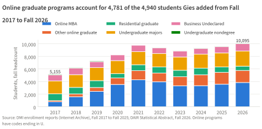
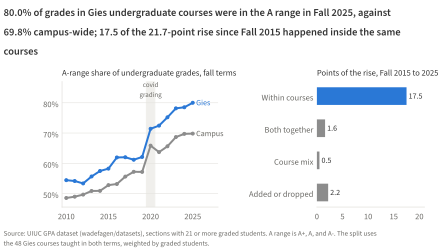
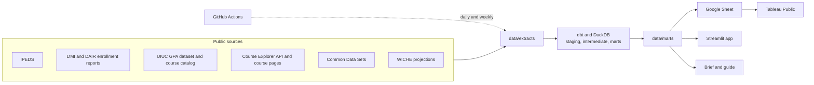

# gies-program-health

An independent look at how the Gies College of Business is doing, built only from public data: enrollment by program, Illinois against the other 17 Big Ten universities, course grades, and how the Spring 2027 schedule fills. I built it as a working sample for analytics roles in higher education, so it runs like a small production pipeline, with tests, scheduled refreshes, and documented decisions, rather than as a one-off notebook. It isn't affiliated with or endorsed by the University of Illinois.

- The brief, four pages: [brief/brief.pdf](brief/brief.pdf)
- The one-page guide to the dashboards: [brief/guide.pdf](brief/guide.pdf)
- The Tableau Public dashboards: [Gies program health on Tableau Public](https://public.tableau.com/app/profile/om.vyas/viz/GiesProgramHealth/Overview)
- The Streamlit app, for enrollment scenarios and the registration watch: [gies-program-health.streamlit.app](https://gies-program-health.streamlit.app/)
- The analysis tables behind every finding, each with its SQL: [docs/findings.md](docs/findings.md)





## How it works



- ingest/ has one module per source. Extracts keep source columns, drop instructor names, and record every file's URL, ETag, and hash in data/extracts/manifest.csv.
- transform/ is a dbt project on DuckDB. Staging types each source, intermediate models hold shared logic, and the exported marts carry enforced column contracts. Its tests check every grain and range, and pin numbers the sources themselves publish.
- forecast/ projects undergraduate headcount as stock and flow and online graduate headcount by exponential smoothing, with a rolling-origin backtest against naive and drift forecasts.
- publish/ writes the marts to data/marts and a Google Sheet for Tableau, and writes docs/findings.md and the daily registration report.
- .github/workflows/ runs a daily snapshot of the Spring 2027 schedule, a daily status pass over the Gies course pages (8:14 am Central, approved by the university's Tech Services), a weekly refresh that re-ingests only sources that changed and publishes only if every test passes, and CI on every push.

## Reproduce it

Python 3.12, and Quarto 1.5 or later for the PDFs.

```bash
python3.12 -m venv .venv
.venv/bin/pip install -r requirements.txt
make all        # download every source, build and test, forecast, export
make findings   # docs/findings.md
make brief      # brief/brief.pdf
make guide      # brief/guide.pdf
make app        # the Streamlit app at localhost:8501
```

`make help` lists every target. docs/runbook.md covers the scheduled jobs, the hand downloads from DAIR, and what to do when a run fails.

## Data

Every source is public; docs/data_sources.md has the details and docs/data_notes.md every quirk found and what I did about it.

1. National Center for Education Statistics, Integrated Postsecondary Education Data System (IPEDS), complete data files.
2. University of Illinois Division of Management Information enrollment reports, Fall 2012 to Fall 2025, from the Internet Archive.
3. University of Illinois Data, Analytics, and Institutional Research (DAIR) dashboards, for Fall 2026 and for retention and graduation by college of entry.
4. W. Fagen-Ulmschneider, UIUC GPA dataset and course catalog (github.com/wadefagen/datasets).
5. University of Illinois Course Explorer API and course pages, Spring 2027.
6. Common Data Sets published by the Big Ten universities.
7. WICHE, Knocking at the College Door, 11th edition.

## Limitations

- IPEDS describes whole universities, so the peer comparisons are about Illinois, not Gies. Gies figures come only from the enrollment reports and DAIR's tables by college of entry.
- Grades describe grading, not learning. The grade data cover sections with 21 or more graded students.
- The registration watch has no seat counts or caps. A closed section isn't necessarily full, and status starts with the Oct 28, 2026 pass.
- The undergraduate projection matched a naive forecast in its backtest rather than beating it; docs/projection_method.md says so plainly.
- Of the Common Data Set rows, only Illinois's are verified so far; the rest are drafts in data/manual/cds_c1_draft.csv.

## Decisions and documentation

docs/decisions.md records each choice and why: DuckDB and dbt instead of a hosted warehouse, a Google Sheet between the pipeline and Tableau Public, nothing paid, and the definitions behind every number. docs/ipeds_variables.md lists every IPEDS variable used with its dictionary description, and docs/tableau_spec.md specifies the dashboards field by field.

This project is not affiliated with or endorsed by the University of Illinois. It uses no university logos or brand marks.
