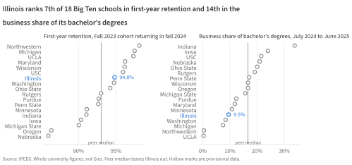
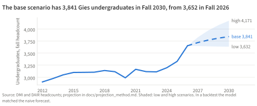

---
format:
  typst:
    papersize: us-letter
    margin:
      x: 0.75in
      y: 0.65in
    mainfont: "Source Serif 4"
    fontsize: 10pt
    font-paths: ["fonts"]
    include-in-header:
      - text: |
          #set text(lang: "en", hyphenate: true)
          #set par(leading: 0.58em)
          #show heading: set text(font: "Source Sans 3", weight: "semibold", size: 12pt)
          #show heading: set block(above: 1.1em, below: 0.6em)
          #show figure: set block(above: 0.9em, below: 0.9em)
          #set figure(placement: bottom)
          #show figure.caption: set text(size: 8.5pt)
execute:
  echo: false
  warning: false
jupyter: python3
---

```{python}
#| include: false
# Quarto runs this from brief/. The module is imported as brief.numbers from the repo root, and
# brief/ comes off the path so its numbers.py can't shadow the standard library's numbers.
import sys
from pathlib import Path

here = Path.cwd().resolve()
sys.path[:] = [p for p in sys.path if Path(p or ".").resolve() != here]
sys.path.insert(0, str(here.parent))
from brief import numbers as n
```

```{=typst}
#text(font: "Source Sans 3", size: 19pt, weight: "semibold")[Gies program health]
#v(-0.6em)
#text(font: "Source Sans 3", size: 10.5pt, fill: rgb("#555555"))[Enrollment, Big Ten peers, course grades, and scheduling at the Gies College of Business, from public data. Om Vyas, #datetime.today().display("[month repr:long] [day padding:none], [year]").]
#v(-0.3em)
#text(size: 8.5pt, style: "italic", fill: rgb("#555555"))[An independent analysis built only from public data, not affiliated with or endorsed by the University of Illinois. Code and data: github.com/omvyas77/program-health.]
```

## Summary

Gies grew from `{python} n.gies_total_first` students in Fall `{python} n.FIRST_CHART_FALL` to `{python} n.gies_total` in Fall `{python} n.LATEST_FALL`, and online graduate programs account for `{python} n.online_added` of the `{python} n.gies_added` added; undergraduate headcount has since risen `{python} n.undergrad_change_five` in five years. Illinois ranks `{python} n.retention_rank` of 18 Big Ten schools in first-year retention but `{python} n.biz_share_rank` in the share of its bachelor's degrees awarded in business. In Gies undergraduate courses, `{python} n.a_range_2025` of grades were in the A range in Fall `{python} n.GRADES_LAST_FALL`, and most of the rise since Fall `{python} n.SHIFT_FROM_FALL` happened within the same courses, so grades tell an assessment committee where to look, not what students learned. `{python} n.watch_count` large courses stand out for the share of students at C or below or withdrawing. My projection puts undergraduate headcount at `{python} n.base_2030` by Fall `{python} n.LAST_PROJECTED_FALL`, though in a backtest it only matched a naive forecast.

## Online programs carried Gies's growth

Gies enrolled `{python} n.gies_total` students in Fall `{python} n.LATEST_FALL`, up from `{python} n.gies_total_first` in Fall `{python} n.FIRST_CHART_FALL`, and online graduate programs account for `{python} n.online_added` of the `{python} n.gies_added` students added (@fig-enrollment). The curriculum reports list no Gies program code ending in U, the marker for an online program, before Fall `{python} n.FIRST_CHART_FALL`. By Fall `{python} n.LATEST_FALL`, `{python} n.online_share` of Gies graduate students, `{python} n.online_count` of `{python} n.graduate_count`, were in an online program, `{python} n.mba_online` of them in the online MBA.

{#fig-enrollment width=90% fig-alt="Stacked bars of Gies fall headcount by program group from Fall 2017 to Fall 2026"}

Growth has since shifted from graduate to undergraduate students. Graduate headcount peaked at `{python} n.graduate_peak` in Fall `{python} n.graduate_peak_fall` and was `{python} n.graduate_decline_five` lower in Fall `{python} n.LATEST_FALL`, while undergraduate headcount rose `{python} n.undergrad_change_five`, from `{python} n.undergrad_total_five_earlier` to `{python} n.undergrad_total`. Fall `{python} n.LATEST_FALL` brought `{python} n.freshmen_latest` first-time freshmen; from Fall `{python} n.first_new_students_fall` to Fall `{python} n.freshmen_range_last_fall` the entering class ranged from `{python} n.freshmen_range_low` to `{python} n.freshmen_range_high`.

Most first- and second-year Gies students are in Business Undeclared, so I measure majors by juniors and seniors. Accountancy went from `{python} n.accy_js_then` in Fall `{python} n.FIVE_FALLS_EARLIER` to `{python} n.accy_js_now` in Fall `{python} n.LATEST_FALL` and Finance from `{python} n.fin_js_then` to `{python} n.fin_js_now`. The three majors paired with Data Science, new in Fall `{python} n.data_science_first_fall`, had `{python} n.data_science_js`.

## Illinois among its Big Ten peers

IPEDS reports the whole university, so these comparisons describe Illinois rather than Gies; where DAIR publishes a Gies figure, I give it too.

Illinois retains first-year students well. Of the `{python} n.retention_label`, `{python} n.retention` returned, `{python} n.retention_rank` of the 18 Big Ten schools and above the peer median of `{python} n.retention_median` (@fig-peers). Retention `{python} n.retention_direction` `{python} n.retention_gain` percentage points from the `{python} n.retention_then_label`, while the peer median `{python} n.retention_median_direction` `{python} n.retention_median_change`. Six-year graduation for the `{python} n.grad6_label` was `{python} n.grad6`, against a peer median of `{python} n.grad6_median`. By college of entry, DAIR puts Gies ahead of the campus: `{python} n.gies_grad6` of Gies's `{python} n.grads_matching_cohort` entrants graduated within six years, against `{python} n.campus_grad6` campus-wide, and `{python} n.gies_retention` of its Fall `{python} n.RETENTION_COHORT` freshmen returned, against `{python} n.campus_retention`.

{#fig-peers width=90% fig-alt="Dot plots of the 18 Big Ten schools on first-year retention and on the business share of bachelor's degrees, with Illinois highlighted"}

Admission has become more selective. Illinois drew `{python} n.applicants` applicants for its `{python} n.admit_label`, up from `{python} n.applicants_then` five years earlier, and admitted `{python} n.admit`, `{python} n.admit_drop` points below the `{python} n.admit_then_label` and below the peer median of `{python} n.admit_median`. Of those admitted, `{python} n.yield_rate` enrolled, against a peer median of `{python} n.yield_median`.

Business is a smaller part of Illinois's undergraduate output than at most peers. Business (CIP 52) accounted for `{python} n.biz_share` of the bachelor's degrees Illinois awarded from `{python} n.biz_share_label`, `{python} n.biz_share_rank` of 18 against a peer median of `{python} n.biz_share_median`. At the master's level the order reverses: Illinois awarded `{python} n.biz_masters` business master's degrees, the most in the Big Ten and `{python} n.biz_masters_ratio` times the peer median. One gap stands out: in the `{python} n.pell_label`, Pell recipients graduated within six years at a rate `{python} n.pell_gap` points below other students, a `{python} n.pell_wider_or_narrower` gap than the peer median of `{python} n.pell_gap_median`.

## What course grades can and can't tell an assessment committee

Grades in Gies undergraduate courses have risen faster than grades across campus. In Fall `{python} n.GRADES_FIRST_FALL`, `{python} n.a_range_2010` of grades in Gies undergraduate courses were in the A range and the mean GPA was `{python} n.gpa_2010`; in Fall `{python} n.GRADES_LAST_FALL` the figures were `{python} n.a_range_2025` and `{python} n.gpa_2025`, across `{python} n.graded_2025` graded students. Campus-wide, the A-range share went from `{python} n.campus_a_2010` to `{python} n.campus_a_2025` and the GPA from `{python} n.campus_gpa_2010` to `{python} n.campus_gpa_2025` (@fig-grades, left). Leaving out the covid terms, when students could take courses credit/no credit, a straight line through the fall terms climbs `{python} n.gies_trend` percentage points a year for Gies and `{python} n.campus_trend` for the campus.

The rise happened inside courses, not through a shift in which courses students took. From Fall `{python} n.SHIFT_FROM_FALL` to Fall `{python} n.SHIFT_TO_FALL` the A-range share rose `{python} n.shift_total` points. In the `{python} n.shift_courses` courses taught in both terms, `{python} n.shift_within` points came from higher shares within the same courses, `{python} n.shift_mix` from enrollment moving toward courses that already graded higher, and `{python} n.shift_interaction` from the two together; courses added or dropped account for the other `{python} n.shift_entering` (@fig-grades, right).

{#fig-grades width=90% fig-alt="Lines of the A-range share in Gies and all undergraduate courses by fall, and bars splitting the rise into within-course change, mix, interaction, and courses added or dropped"}

Grades describe grading, not learning. A rising share of A grades can reflect better-prepared students, changes in how courses assess, or changes in how they grade, and these data can't tell those apart. What they can do is show a committee where direct evidence would be worth collecting.

Failing and withdrawing are rare (`{python} n.dfw_2025` of grades in Gies undergraduate courses in Fall `{python} n.GRADES_LAST_FALL` were D, F, or W), so the share at C or below or withdrawing says more. In `{python} n.watch_count` courses with `{python} n.watch_min_graded` or more graded students a term, `{python} n.watch_min_rate` or more of students were at C or below or withdrew in at least `{python} n.watch_min_terms` of the last four long terms: `{python} n.watch_courses` (`{python} n.watch_top_rate` over four terms in `{python} n.watch_top_course`). Each is a question for its department about preparation, placement, and support, not a verdict on its teaching.

Sections of one course differ too: in the last four long terms, section GPAs within a Gies undergraduate course were up to `{python} n.spread_max` points apart. That shows where common assessments or rubrics could be compared, not which section graded correctly.

AACSB's 2026 Global Standards take effect in 2027-28, after a 2026-27 pilot year with about 30 schools, and continuous improvement reviews with visits from 2027-28 on use them [8]. Standard 5 asks for direct and indirect measures of learning tied to stated competencies; grade distributions are neither, but they show where to apply such measures first. The watch list belongs under Standard 6, learner progression, and section spread is a place for Standard 7's review of teaching effectiveness to start.

## Where scheduling is tight

Gies offered `{python} n.sections_2025` primary sections, lectures and seminars rather than discussions or labs, in Fall `{python} n.SECTIONS_TO_FALL`, against `{python} n.sections_2019` in Fall `{python} n.SECTIONS_FROM_FALL`, while graded students rose from `{python} n.students_2019` to `{python} n.students_2025`. Graded students per primary section went from `{python} n.per_section_2019` to `{python} n.per_section_2025`. That runs a little low, because the GPA data leave out sections of 20 or fewer graded students; I don't use the GPA data's own section count, because grades moved from discussion sections to lectures over these years. `{python} n.fewer_sections_count` courses ran fewer primary sections in Fall `{python} n.SECTIONS_TO_FALL` than in Fall `{python} n.SECTIONS_FROM_FALL` while their graded students rose: `{python} n.fewer_sections_list`.

A scheduled job reads the Spring 2027 schedule from Course Explorer every day. As of `{python} n.snapshot_date`, `{python} n.registration_status`, and Gies listed `{python} n.registration_sections` primary sections in `{python} n.registration_courses` courses. The public schedule shows sections added and removed but has no seat counts, caps, waitlists, or open and closed status. The usual scheduling measure, average enrollment over average enrollment cap, needs exactly what is missing, so a section added during registration is a hint of demand and nothing more.

## Outlook

I project Gies undergraduate headcount as a stock and flow: next fall's undergraduates are the first-time freshmen and new transfers who arrive plus the share of this fall's undergraduates who continue. The base scenario holds freshmen at `{python} n.base_freshmen` and transfers at `{python} n.base_transfers` a year, their mean over Falls `{python} n.intake_first_fall` to `{python} n.LATEST_FALL`, and the continuing share at `{python} n.base_c_pct`, the median of the last five fall-to-fall transitions outside covid. It reaches `{python} n.base_2030` undergraduates by Fall `{python} n.LAST_PROJECTED_FALL`, with low and high scenarios of `{python} n.low_2030` and `{python} n.high_2030` (@fig-projection).

{#fig-projection width=90% fig-alt="Line of Gies undergraduate headcount from 2012 to 2026 with the base projection to 2030 and a shaded low-to-high range"}

In a backtest from Fall `{python} n.BACKTEST_FIRST_ORIGIN` on, the model's mean absolute percentage error was `{python} n.model_1yr` one year ahead and `{python} n.model_4yr` four years ahead, against `{python} n.naive_1yr` and `{python} n.naive_4yr` for simply carrying the last fall forward. That margin is too small to call a win: the model matches the naive forecast rather than beating it. Most of its error comes from guessing intake. Given the freshmen and transfers who actually arrived, the one-year error falls to `{python} n.actual_intake_1yr`.

So the levers are intake and continuation. Each `{python} n.FRESHMEN_LEVER` more freshmen a year adds `{python} n.plus_50_freshmen` undergraduates by Fall `{python} n.LAST_PROJECTED_FALL`, and each percentage point of continuing share adds `{python} n.plus_point_c`. If freshmen held at Fall `{python} n.LATEST_FALL`'s `{python} n.freshmen_latest`, the base would reach `{python} n.freshmen_hold`.

Online graduate headcount is projected flat at `{python} n.online_count`, with an 80% range of `{python} n.online_low_2030` to `{python} n.online_high_2030` by Fall `{python} n.LAST_PROJECTED_FALL`; a damped trend, which carried the programs' early growth forward, lost to the naive forecast at every horizon.

```{python}
#| output: asis
lead = (
    f"WICHE projects Illinois's public and private high school graduates to fall from "
    f"{n.il_grads_2025} in the class of {n.WICHE_FROM} to {n.il_grads_2035} in {n.WICHE_TO}, "
    f"{n.il_grads_decline} fewer [7]."
)
if n.what_if_ready:
    print(
        f"{lead} If UIUC's in-state applicants fell in step and in-state yield held at its Fall "
        f"{n.WICHE_FROM} level of {n.in_state_yield_2025}, keeping in-state enrollment flat "
        f"would take an in-state admit rate of {n.in_state_admit_2035} by Fall {n.WICHE_TO}, "
        f"against {n.in_state_admit_2025} in Fall {n.WICHE_FROM}. This is a what-if for the "
        "whole university, not a forecast."
    )
else:
    print(
        f"{lead} A what-if on that decline, the in-state admit rate that would keep in-state "
        "enrollment flat, waits on verified Common Data Set figures for Illinois."
    )
```

## What an internal version would add

Public data stop where the questions get specific. Student records would give retention and graduation by program and major, including the online programs, rather than by college of entry. Course evaluation results would add the evidence about teaching that Standard 7 asks for and grades can't supply. The admissions system would give Gies's own funnel, which IPEDS reports only for the university. The scheduling system would give caps and waitlists, turning the registration watch into fill ratios. And the assurance-of-learning results Gies already collects could be read against the grade patterns here.

## Methods and sources

Every number in this brief is computed from the project's data marts by code in the repository; the analysis tables behind it are in docs/findings.md, and the projection's equations and backtest in docs/projection_method.md. Peer medians are the median of the 17 Big Ten schools other than Illinois. Penn State is missing from its 2019 to 2021 IPEDS collections, when it reported all campuses together.

```{=typst}
#set text(size: 8.5pt)
```

1. NCES, Integrated Postsecondary Education Data System, complete data files.
2. UIUC Division of Management Information, enrollment reports, Fall 2012 to Fall 2025, via the Internet Archive.
3. UIUC Data, Analytics, and Institutional Research, Statistical Abstract; Retention and Graduation Rates.
4. W. Fagen-Ulmschneider, UIUC GPA dataset and course catalog, github.com/wadefagen/datasets.
5. UIUC Course Explorer API, daily Spring 2027 snapshots.
6. Common Data Sets of the Big Ten universities, 2024-25 and 2025-26.
7. WICHE, Knocking at the College Door, 11th edition, 2024.
8. AACSB, Global Standards for Business Education, 2026, aacsb.edu/educators/global-standards.
